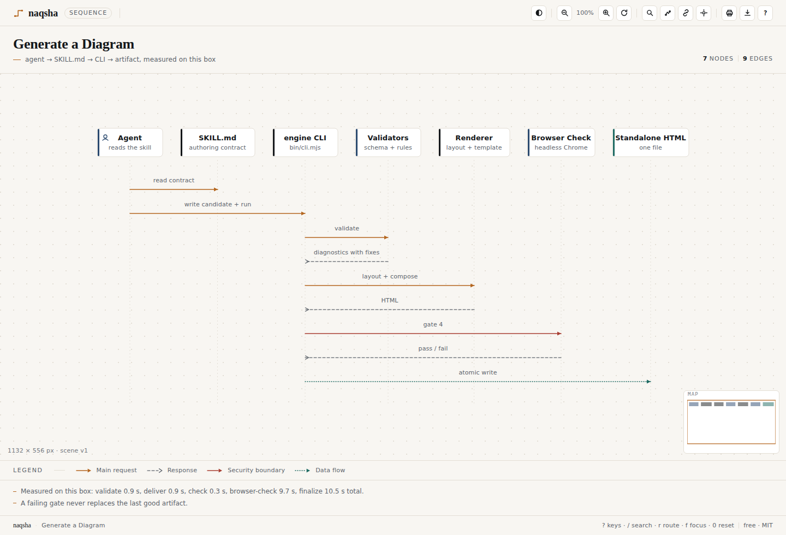
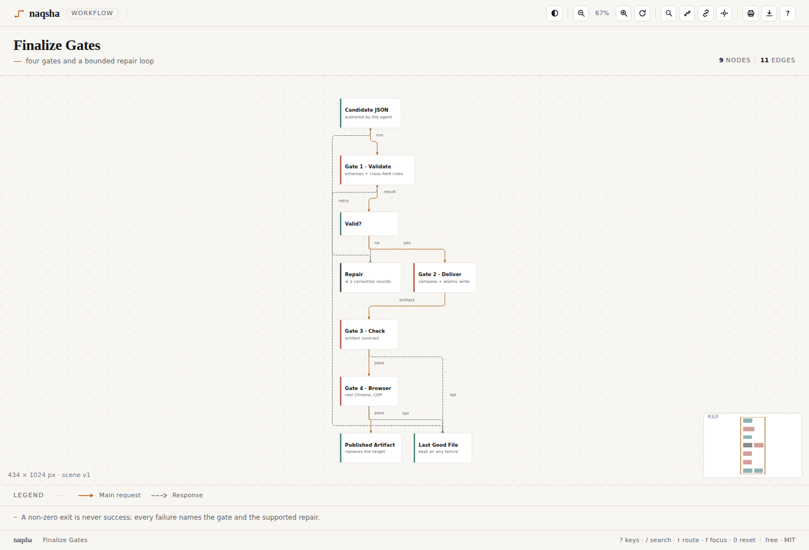
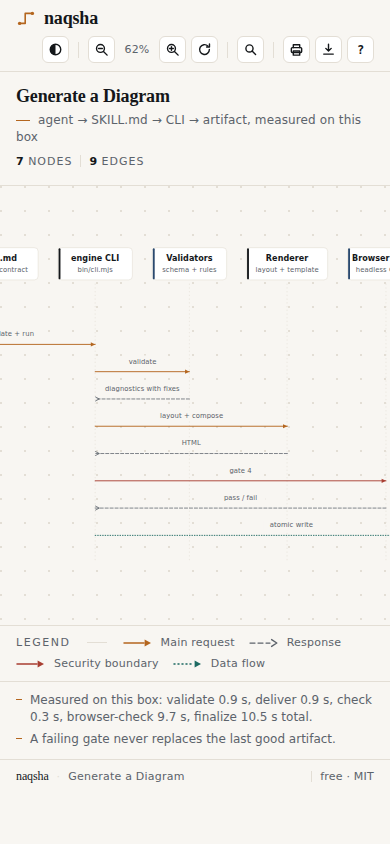
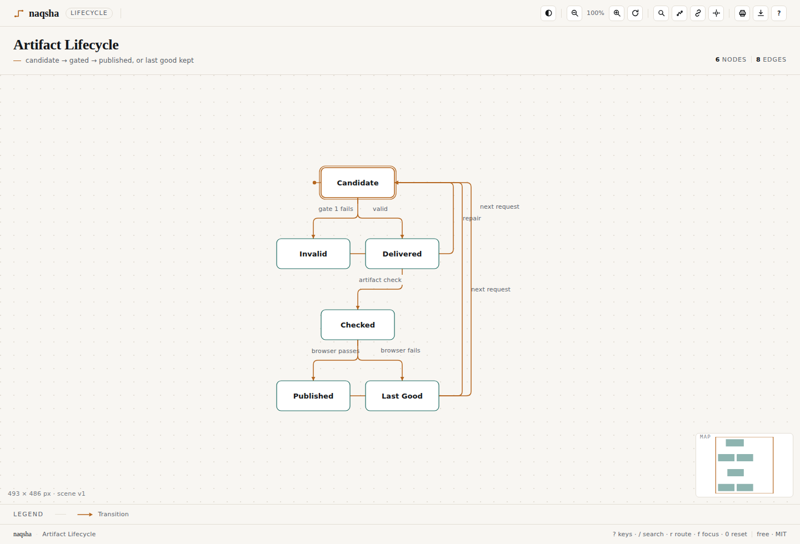
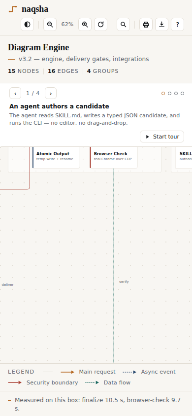

# naqsha

[](https://github.com/horizonbymuneeb/naqsha/actions/workflows/ci.yml) [](https://github.com/horizonbymuneeb/naqsha/releases) [](https://www.npmjs.com/package/naqsha-cli) [](https://www.npmjs.com/package/naqsha-cli) [](LICENSE)

**A free diagram skill for every coding agent.** One small JSON file in, one
self-contained interactive HTML out: no npm install for the reader, no network,
no fonts, no hosted service, no account. Ten diagram types, ten native layouts.

## Install

One command per machine, no clone needed — the npm package ships the skill
payload (`SKILL.md`, `src/`, `examples/`) and the `naqsha` CLI:

```bash
npm i -g naqsha-cli
naqsha install-skill --agent all      # or --agent claude / dsh / codex / ...
```

| Agent | Skill root | Command |
|---|---|---|
| DeepSeek Harness (DSH) | `~/.dsh-home/skills/naqsha` | `naqsha install-skill --agent dsh` |
| Claude Code | `~/.claude/skills/naqsha` | `naqsha install-skill --agent claude` |
| Codex | `~/.agents/skills/naqsha` | `naqsha install-skill --agent codex` |
| Hermes | `~/.agents/skills/naqsha` | `naqsha install-skill --agent hermes` |
| opencode | `~/.config/opencode/skills/naqsha` | `naqsha install-skill --agent opencode` |
| Cursor | `~/.cursor/skills/naqsha` | `naqsha install-skill --agent cursor` |
| Gemini CLI | `~/.gemini/skills/naqsha` | `naqsha install-skill --agent gemini` |

`naqsha install-skill --list` shows the map; `--prefix DIR` installs into a
throwaway prefix; the installer rewrites the skill's absolute path and finishes
with a real validate + render.

**Prefer a clone?** Contributors and offline machines can use the same installer
straight from the repository:

```bash
git clone https://github.com/horizonbymuneeb/naqsha && cd naqsha
./install.sh --agent all
```

Published: **https://github.com/horizonbymuneeb/naqsha** ·
[npm](https://www.npmjs.com/package/naqsha-cli) — MIT, English-only, zero runtime
dependencies, Node ≥18. Detailed per-agent steps: [docs/INSTALL.md](https://github.com/horizonbymuneeb/naqsha/blob/master/docs/INSTALL.md).

Then ask your agent:

> use naqsha to map this repo's runtime architecture

The agent reads the skill, writes one JSON candidate, validates it, and hands you
a single interactive HTML page.

## Ten diagram types

| Type | Use for | Extra IR fields |
|---|---|---|
| `architecture` | services, stores, actors, trust boundaries | — |
| `workflow` | ordered steps, decisions, retries | `direction` |
| `sequence` | messages between participants over time | — |
| `erd` | tables, columns, keys, cardinality | `attributes[{name,type,key,ref}]`, `cardinality` |
| `class` | types, members, inheritance, composition | `stereotype`, `members[]`, relation `kind` |
| `tree` | single-parent hierarchy from one root | — |
| `timeline` | dated events on a time axis | `at`, `lane` |
| `waterfall` | spans with start + duration on one axis | `start`, `duration`, `lane` |
| `dataflow` | pipeline stages, left to right | `stage` |
| `lifecycle` | states and transitions, start/end emphasis | transition `label` |

`naqsha types` prints the catalog.

## Live demos

**Browse them at [horizonbymuneeb.github.io/naqsha](https://horizonbymuneeb.github.io/naqsha/)** — served straight from `docs/`.

Every file below is a single self-contained HTML rendered from a JSON file in
`examples/` — open it by double-clicking, no server, no CDN.

| Artifact | What it shows | Command that made it |
|---|---|---|
| [`docs/demo-naqsha-repo.html`](docs/demo-naqsha-repo.html) | **This project mapping itself**, end to end: skill contract, CLI, validator, render pipeline, release gates and distribution — **with a 4-step guided tour** — press `→` or Space | `naqsha render examples/naqsha-repo.architecture.json docs/demo-naqsha-repo.html` |
| [`docs/demo-architecture.html`](docs/demo-architecture.html) | A v3.2 engine runtime: agent surface, core, delivery gates, host adapter, **with a 4-step guided tour** — press `→` or Space | `naqsha render examples/engine-repo.architecture.json docs/demo-architecture.html` |
| [`docs/demo-diff.html`](docs/demo-diff.html) | **Diagram diff** of v3.1 → v3.2: the mode that landed is ringed green, changed labels are marked, counts sit in the header | `naqsha diff examples/engine-repo.v31.architecture.json examples/engine-repo.architecture.json docs/demo-diff.html` |
| [`docs/demo-generate.sequence.html`](docs/demo-generate.sequence.html) | A real generate run: agent → SKILL.md → CLI → validators → renderer → browser gate → artifact | `naqsha render examples/generate-run.sequence.json docs/demo-generate.sequence.html` |
| [`docs/demo-finalize.workflow.html`](docs/demo-finalize.workflow.html) | The four finalize gates and the bounded repair loop, failure paths included | `naqsha render examples/finalize-gates.workflow.json docs/demo-finalize.workflow.html` |
| [`docs/demo-mermaid.html`](docs/demo-mermaid.html) | A **Mermaid** `sequenceDiagram` ingested with `convert` and re-rendered | `naqsha convert test/mermaid/sequence-loop.mmd /tmp/s.json && naqsha render /tmp/s.json docs/demo-mermaid.html` |

### One demo per diagram type

| Type | Artifact | Source JSON |
|---|---|---|
| architecture | [`docs/demo-architecture.html`](docs/demo-architecture.html) | `examples/engine-repo.architecture.json` |
| workflow | [`docs/demo-finalize.workflow.html`](docs/demo-finalize.workflow.html) | `examples/finalize-gates.workflow.json` |
| sequence | [`docs/demo-generate.sequence.html`](docs/demo-generate.sequence.html) | `examples/generate-run.sequence.json` |
| erd | [`docs/demo-ir.erd.html`](docs/demo-ir.erd.html) | `examples/ir-schema.erd.json` |
| class | [`docs/demo-modules.class.html`](docs/demo-modules.class.html) | `examples/engine-modules.class.json` |
| tree | [`docs/demo-tree.tree.html`](docs/demo-tree.tree.html) | `examples/repo-layout.tree.json` |
| timeline | [`docs/demo-release.timeline.html`](docs/demo-release.timeline.html) | `examples/release-history.timeline.json` |
| waterfall | [`docs/demo-finalize.waterfall.html`](docs/demo-finalize.waterfall.html) | `examples/finalize-timings.waterfall.json` |
| dataflow | [`docs/demo-evidence.dataflow.html`](docs/demo-evidence.dataflow.html) | `examples/evidence-flow.dataflow.json` |
| lifecycle | [`docs/demo-artifact.lifecycle.html`](docs/demo-artifact.lifecycle.html) | `examples/artifact-lifecycle.lifecycle.json` |

## The input format

A candidate is a small typed JSON document. This excerpt is the real head of
`examples/engine-repo.architecture.json`:

```json
{
  "title": "Diagram Engine",
  "subtitle": "v3.2 — engine, delivery gates, integrations",
  "type": "architecture",
  "groups": [
    { "id": "engine", "label": "Engine", "kind": "zone",
      "nodes": ["cli", "validators", "layout", "renderers", "template"] }
  ],
  "nodes": [
    { "id": "agent", "label": "Agent", "sublabel": "reads SKILL.md, writes candidate", "kind": "actor" },
    { "id": "cli", "label": "bin/cli.mjs", "sublabel": "validate · render · deliver · finalize",
      "kind": "service", "group": "engine" },
    { "id": "finalize", "label": "bin/finalize.mjs", "sublabel": "validate → deliver → check → browser",
      "kind": "service" }
  ],
  "edges": [
    { "from": "agent", "to": "cli", "label": "run command", "kind": "main" },
    { "from": "cli", "to": "validators", "label": "validate", "kind": "main" }
  ],
  "walkthrough": [
    { "title": "An agent authors a candidate",
      "text": "The agent reads SKILL.md, writes a typed JSON candidate, and runs the CLI.",
      "focus": ["agent", "skill", "cli"] }
  ]
}
```

Render it:

```bash
node src/cli/naqsha.mjs validate examples/engine-repo.architecture.json --json
node src/cli/naqsha.mjs render   examples/engine-repo.architecture.json /tmp/engine.html
node src/cli/naqsha.mjs screenshot /tmp/engine.html /tmp/engine.png   # needs a real Chrome
```

Bad JSON never becomes a broken page: the validator returns rule codes with the
exact field path and a fix hint, and `naqsha fix` repairs ids, kinds, unknown
keys and dangling references deterministically.

| Sequence | Workflow (four gates) | Mobile |
|---|---|---|
|  |  |  |

## Try the features

```bash
# 1. a guided walkthrough: the JSON carries the narration
naqsha render examples/engine-repo.architecture.json /tmp/engine.html   # press → / Space

# 2. a diagram diff: two IRs in, one red/green artifact out
naqsha diff examples/engine-repo.v31.architecture.json examples/engine-repo.architecture.json /tmp/drift.html

# 3. path tracing: which route does a run take from the agent to the artifact?
naqsha path examples/engine-repo.architecture.json agent artifact

# 4. bring a Mermaid diagram in, then heal whatever it could not express
naqsha convert test/mermaid/basic-flow.mmd /tmp/flow.json
naqsha fix /tmp/flow.json --json

# 5. round-trip back to Mermaid (paste it into a README or PR comment)
naqsha mermaid examples/engine-repo.architecture.json /tmp/engine.mmd

# 6. export from the page itself: SVG, PNG, WebP, JPEG, Mermaid, JSON
```

## What the reader gets

| Live in the page (no network, no libs) | |
|---|---|
| Focus & dim | click/hover a box: it, its edges and 1-hop neighbours stay lit |
| Walkthrough tour | authored 3–10 steps, `→`/Space to walk, dots to jump |
| Minimap | corner radar, click/drag to navigate |
| Search | `/` filters labels, Enter flies to the match |
| Share link | `#focus=`, `#step=`, `#z=`, `#route=` round-trip + Copy link |
| Inspector | node panel with clickable inbound/outbound neighbours |
| Route tracing | `r`, pick two nodes, get the hop list and the lit path |
| Legend filter | click a kind to hide it, click again to restore |
| Presentation laser | `p` hides chrome and follows the pointer |
| Keyboard help | `?` lists every binding |
| Export | SVG, PNG 2×, WebP, JPEG, **Mermaid**, JSON — generated in the page |
| Diff styling | added/removed/changed rings + counts for `naqsha diff` artifacts |
| Print | one page, chrome hidden, fits the sheet |
| Theme | light / dark / system, remembered |
| Mobile | pinch-zoom, double-tap reset, pan, no page overflow |

Hover or click any box to focus it and its one-hop neighbours; the rest dims.
Wheel to zoom, drag to pan, `0` to reset, `f` for focus mode, a theme toggle
(light / dark / system, remembered across reloads), and a print stylesheet that
puts the diagram on one page. Participants, lifelines and fragments are real
geometry — not a markdown image. The page is `role="img"` with labelled nodes
and an `aria-live` status line, so it reads in a screen reader too.

| Desktop, 1440×980 | Phone, 390×844 |
|---|---|
|  |  |

## CLI

| Command | What it does |
|---|---|
| `naqsha validate in.json` | schema + cross-field rules; `--json` prints a receipt |
| `naqsha render in.json out.html` | layout + compose the standalone page |
| `naqsha diff base.json head.json out.html` | structural diff as one artifact |
| `naqsha path in.json A B` | hop list between two nodes |
| `naqsha convert file.mmd out.json` | Mermaid flowchart / sequence → IR |
| `naqsha mermaid in.json out.mmd` | IR → Mermaid |
| `naqsha fix in.json [--write]` | deterministic repair of a broken candidate |
| `naqsha validate --explain` / `naqsha types` | rule catalog, type catalog |
| `naqsha demo DIR` / `doctor` / `screenshot in.html out.png` | starter set, environment report, headless capture |
| `naqsha install-skill [--agent NAME] [--list]` | register the skill into one or all agents |

## How it is checked

Every artifact in `docs/` is produced by the same commands the README shows, and
every claim above is gated:

```bash
node --test test/                  # 163 unit tests: validator, CLI, render, all ten layouts, diff, convert, repair
./verify.sh                        # 165 acceptance checks: render every example, size, offline, determinism,
                                   #   layout sanity, real-Chrome overflow/console at 1440×980 and 390×844, screenshots
node scripts/interact-check.mjs    # 47–55 live-HTML checks per artifact over CDP: focus/dim, tour, search,
                                   #   share state, inspector, route tracing, export, theme, print, a11y, mobile
```

`scripts/verify.mjs` and `scripts/interact-check.mjs` drive a real Chrome over
the DevTools protocol, so the viewport is exact and the checks are measurements,
not assertions about intentions. Both need a Chrome/Chromium binary
(`NAQSHA_CHROME`). `/usr/bin/chromium-browser` snap stubs are skipped on purpose.

## Install details

Per-agent commands, the npm route, custom prefixes, upgrading and uninstall are
in **[docs/INSTALL.md](docs/INSTALL.md)**. The short version:

```bash
naqsha install-skill --list                                  # agent → skills root
naqsha install-skill --prefix /tmp/test-install --agent dsh  # keep a test install out of $HOME
naqsha install-skill --agent all                             # no prompts, idempotent
```

`naqsha install-skill` runs the same `install.sh` the clone ships; it also writes
`~/.config/naqsha/env.sh` with a Chrome hint and adds a `~/.local/bin/naqsha` launcher. Chrome is only needed for `naqsha screenshot`
and the browser-check harnesses; rendering is pure Node.

## Uninstall

```bash
rm -rf ~/.dsh-home/skills/naqsha ~/.agents/skills/naqsha ~/.claude/skills/naqsha \
       ~/.config/opencode/skills/naqsha ~/.cursor/skills/naqsha ~/.gemini/skills/naqsha \
       ~/.local/bin/naqsha ~/.config/naqsha
```

## Honest positioning

The skill exists because an agent needs different things from a diagram tool
than a human does:

| Capability | naqsha | Mermaid | draw.io / d2 |
|---|---|---|---|
| **Guided walkthrough** — narration lives in the JSON | ✅ | ❌ | ❌ |
| **Diagram diff artifact** — `diff base.json head.json` | ✅ | ❌ | ❌ |
| **Path tracing** — `path in.json a b` + `#path=` highlight | ✅ | ❌ | ❌ |
| **Self-healing IR** — `fix` repairs deterministically | ✅ | n/a | n/a |
| **Mermaid ingest** — `convert flow.mmd out.json` | ✅ | native | ❌ |
| **Offline single file, zero deps, no telemetry** | ✅ | library, needs JS | app / compiler |
| **Diagram types** | **10** | ~20 | many |

Mermaid remains the right tool inside a README; draw.io and d2 are app or
compiler workflows. naqsha wins on what an agent needs: narration, diffs, path
answers, repair, and a self-contained page with no renderer on the reader's
side.

## License

MIT. See [LICENSE](LICENSE); third-party attributions in
[LICENSES/ATTRIBUTION.md](LICENSES/ATTRIBUTION.md).
